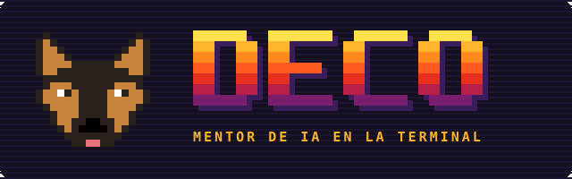
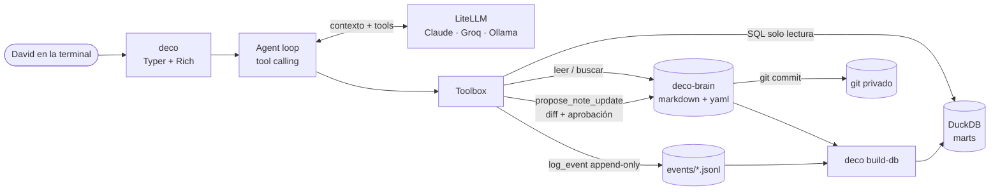
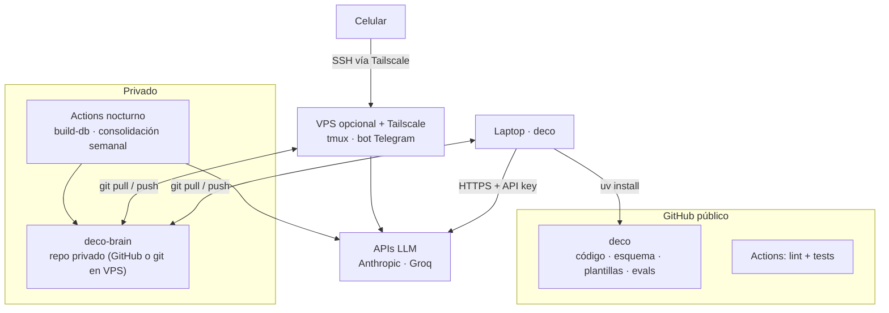

<h1 align="center">
  
</h1>

**Deco** es mi asesor técnico de IA en la terminal para proyectos de **Analytics Engineering, Data Engineering y AI Engineering**. Funciona como un par senior: revisa arquitecturas y modelos de datos, diagnostica problemas, cuestiona decisiones de diseño y me ayuda a construir con estándares de producción, tanto en proyectos personales como profesionales.

También es mi tutor. Conoce mis proyectos, mis skills y cómo vienen evolucionando: qué fui
fortaleciendo en el trabajo y en proyectos propios, y dónde todavía tengo margen de mejora.
Con eso arma planes de estudio y práctica para seguir creciendo, y está pensado para
acompañarme hacia nuevas áreas, como gobernanza de datos o machine learning.

¿La diferencia con un chat común? **El criterio se apoya en evidencia, y la memoria es mía.**
Deco no responde "de memoria": cita las fuentes de mi brain, separa hechos de inferencias y
consulta datos reales antes de recomendar. Esa memoria no queda en ningún proveedor de IA:
vive en un repo privado con archivos de texto y en una DuckDB que se arma a partir de ellos.
Puedo ver, editar y versionar todo lo que Deco "sabe", y cambiar de modelo sin perder nada.

> El modelo es intercambiable (Claude, Groq, Ollama vía LiteLLM). El activo es la memoria
> y las reglas de cómo se lee y se escribe.

## Qué hace

**Como asesor técnico**
- Revisión de arquitectura, modelos de datos y decisiones de diseño, conversando sobre mis proyectos
- Diagnóstico de problemas y trade-offs, con criterio basado en estándares (`deco-library/standards`, en desarrollo)
- Análisis de perfiles técnicos: compara los requerimientos de un rol con mis skills y su evidencia (`/jd`)

**Como tutor**
- `/learn <tema>`: explicación por bloques, de lo básico a lo complejo, con preguntas y corrección
- `/mock <tema>`: sesión de preguntas técnicas con puntaje registrado
- `/roadmap [foco]`: plan priorizado con datos (brecha de skill × relevancia en la industria)
- `/checkin` y `/weekly`: seguimiento del avance

| Comando | Para qué |
|---|---|
| `deco` | abre la sesión (`/help` muestra todos los comandos) |
| `/lang es\|en\|mix` | idioma; `mix` explica en español y practica en inglés |
| `deco sql "..."` | SQL directo sobre mis marts |
| `deco build-db` | reconstruye la DuckDB desde el brain |

## Arquitectura local



**Principios de diseño**
- **Fuente de verdad en texto** (markdown/yaml/jsonl versionados). DuckDB e índices son derivados y reconstruibles.
- **Human-in-the-loop**: el modelo propone cambios a la memoria como diff; yo apruebo; queda un commit.
- **Anti-alucinación**: citas obligatorias a archivos del brain, hechos vs. inferencias, niveles de skill solo con evidencia, SQL de solo lectura.
- **Robustez frente al modelo**: reintentos ante límites del proveedor, tope de tokens y corte de respuestas en bucle.
- **Extensible por dominios**: agregar `ml` o `data_governance` es agregar un bloque en `skills.yaml`.

## Arquitectura de infraestructura



## Modelo de datos

`skills` · `events` · `projects` · `jobs` · `job_requirements` → marts:
`mart_skill_gaps` (prioridad = brecha de nivel × relevancia en los roles analizados),
`mart_unmapped_requirements`, `mart_weekly_activity`. Ver [`src/deco/db/schema.sql`](src/deco/db/schema.sql).

## Quickstart

```bash
git clone https://github.com/<tu-usuario>/deco && cd deco
uv venv && uv pip install -e ".[dev]"      # o: pip install -e ".[dev]"
cp .env.example .env                       # completá API key y DECO_BRAIN_PATH
uv run deco init ~/deco-brain              # crea tu memoria (repo git PRIVADO)
uv run deco
```

## Stack
Python · LiteLLM · Typer/Rich · DuckDB · (dbt-duckdb, embeddings, MCP en el roadmap) · GitHub Actions

Roadmap: [`docs/ROADMAP.md`](docs/ROADMAP.md) · Decisiones: [`docs/DECISIONS.md`](docs/DECISIONS.md)