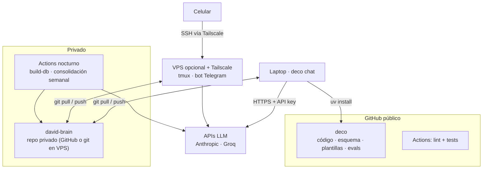

<h1 align="center">
  
</h1>

**Deco** es mi mentor de IA en la terminal. Lo armé para acompañarme en mi aprendizaje
y en mi maduración profesional en áreas como **Analytics Engineering, Data Engineering
y AI Engineering**, y en las que vaya sumando con el tiempo, como gobernanza de datos
o machine learning. Sabe en qué ando, qué proyectos hice, qué construyo, qué me cuesta y qué me falta practicar, y me ayuda a armar un camino concreto para seguir creciendo.

¿La diferencia con un chat común? **La memoria es mía.** No queda guardada en ningún
proveedor de IA: vive en un repo privado con archivos de texto y en una DuckDB que se
arma a partir de ellos. Puedo ver, editar y versionar todo lo que Deco "sabe" de mí,
y cambiar de modelo cuando quiera sin perder nada.

> El modelo es intercambiable (Claude, Groq, Ollama vía LiteLLM). El activo es la memoria
> y las reglas de cómo se lee y se escribe.

## Qué hace

| Comando | Para qué |
|---|---|
| `deco chat` | sesión interactiva con herramientas |
| `/checkin` | check-in guiado → journal + eventos + propuestas de skills |
| `/jd puesto.txt` | fit contra mis skills, gaps, plan de estudio y bullets de CV **solo con evidencia** |
| `/mock sql` | entrevista simulada con puntaje registrado |
| `/roadmap [foco]` | roadmap de 4 semanas priorizado con datos (brecha × demanda) |
| `/weekly` | revisión semanal con métricas |
| `deco sql "..."` | SQL directo sobre mis marts |

## Arquitectura local


**Principios de diseño**
- **Fuente de verdad en texto** (markdown/yaml/jsonl versionados). DuckDB e índices son derivados y reconstruibles.
- **Human-in-the-loop**: el modelo propone cambios a la memoria como diff; yo apruebo; queda un commit.
- **Anti-alucinación**: citas obligatorias a archivos del brain, hechos vs. inferencias, niveles de skill solo con evidencia, SQL de solo lectura.
- **Extensible por dominios**: agregar `ml` o `data_governance` es agregar un bloque en `skills.yaml`.

## Arquitectura de infraestructura



## Modelo de datos

`skills` · `events` · `projects` · `jobs` · `job_requirements` → marts:
`mart_skill_gaps` (prioridad = brecha de nivel × demanda en los puestos que guardé),
`mart_unmapped_requirements`, `mart_weekly_activity`. Ver [`src/deco/db/schema.sql`](src/deco/db/schema.sql).

## Quickstart

```bash
git clone https://github.com/<tu-usuario>/deco && cd deco
uv venv && uv pip install -e ".[dev]"      # o: pip install -e ".[dev]"
cp .env.example .env                       # completá API key y DECO_BRAIN_PATH
uv run deco init ~/david-brain               # crea tu memoria (repo git PRIVADO)
uv run deco chat
```

## Stack
Python · LiteLLM · Typer/Rich · DuckDB · (dbt-duckdb, embeddings, MCP en el roadmap) · GitHub Actions

Roadmap: [`docs/ROADMAP.md`](docs/ROADMAP.md) · Decisiones: [`docs/DECISIONS.md`](docs/DECISIONS.md)
